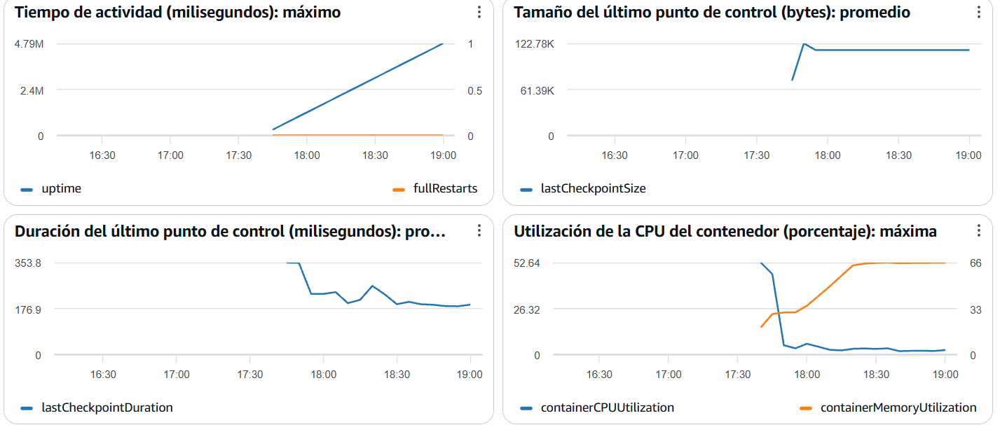

# Evidencia de ejecución — Managed Service for Apache Flink (Pre-entrega 4)

Registro de la corrida de `data-platform-dev-flink` del 2026-11-01 (cuenta `659500704179`, `us-east-1`). Los pasos para reproducirla están en el [README](README.md#7-despliegue). Las capturas se guardan en [docs/evidencias-flink/](docs/evidencias-flink/).

## 1. Despliegue

Con `flink_start_application = true` en `terraform.tfvars`, `terraform plan` posterior al apply no muestra cambios de infraestructura (el código coincide con lo desplegado):

```text
Changes to Outputs:
  ~ flink_application_status = "READY" -> "RUNNING"

You can apply this plan to save these new output values to the Terraform
state, without changing any real infrastructure.
```

## 2. Aplicación en ejecución

```powershell
aws kinesisanalyticsv2 describe-application --application-name data-platform-dev-flink `
  --query "ApplicationDetail.{Estado:ApplicationStatus,Version:ApplicationVersionId,Paralelismo:ApplicationConfigurationDescription.FlinkApplicationConfigurationDescription.ParallelismConfigurationDescription.CurrentParallelism,Checkpoints:ApplicationConfigurationDescription.FlinkApplicationConfigurationDescription.CheckpointConfigurationDescription.CheckpointingEnabled}" --output table
```

```text
------------------------------------------------------
|                 DescribeApplication                |
+--------------+----------+---------------+----------+
|  Checkpoints | Estado   |  Paralelismo  | Version  |
+--------------+----------+---------------+----------+
|  True        |  RUNNING |  2            |  1       |
+--------------+----------+---------------+----------+
```

La aplicación leyó sus runtime properties (log de arranque):

```text
INFO:flink-app:Configuracion: stream=data-platform-dev-events region=us-east-1 initpos=LATEST salida=s3://data-platform-dev-659500704179-bucket/flink/resultados/ watermark=30s
```

## 3. Tráfico de prueba

```powershell
python .\scripts\kinesis_producer.py --lotes 24 --registros 20 --pausa 10 --max-retraso 20
```

```text
Lote 24/24: 20 eventos enviados
Proceso terminado. Registros enviados: 480
Stream: data-platform-dev-events
Claves de partición: 10 clientes diferentes
```

480 eventos en unos 4 minutos, con timestamps retrasados al azar hasta 20 s para simular desorden (dentro de la tolerancia de 30 s del watermark).

## 4. Grafo del job (Flink Dashboard)

Consola de AWS -> Managed Apache Flink -> `data-platform-dev-flink` -> *Open Apache Flink dashboard* -> *Running Jobs*.



Qué se ve: fuente Kinesis con watermark -> `LocalWindowAggregate` / `GlobalWindowAggregate` (TUMBLE 1 min) -> `TableToDataSteam` -> `deteccion-patrones-por-cliente` -> sink de archivos.

## 5. Checkpoints completados

Logs del `CheckpointCoordinator` (el tamaño corresponde al estado de ventanas y `ValueState` por cliente):

```text
Completed checkpoint 6 for job de4ebc1c2f31d41340bd2e276881c2c3 (146959 bytes, checkpointDuration=710 ms, finalizationTime=323 ms).
Completed checkpoint 7 for job de4ebc1c2f31d41340bd2e276881c2c3 (147438 bytes, checkpointDuration=789 ms, finalizationTime=257 ms).
```


## 6. Logs de CloudWatch: resultados por ventana

```powershell
aws logs filter-log-events --log-group-name /aws/kinesis-analytics/data-platform-dev-flink `
  --filter-pattern VENTANA --max-items 20 --query "events[].message" --output text
```

37 resultados de ventana en la corrida, 0 líneas `ERROR`. Últimos resultados (ventana 17:50 UTC):

```text
VENTANA cliente=cliente-002 inicio=2026-11-01 17:50:00.000 operaciones=11 compras=11 importe=2739.30 acumulado=9540.51 ventanas=4 variacion_pct=-16.09 alerta=None
VENTANA cliente=cliente-010 inicio=2026-11-01 17:50:00.000 operaciones=12 compras=12 importe=3733.86 acumulado=10124.16 ventanas=4 variacion_pct=-9.97 alerta=None
VENTANA cliente=cliente-004 inicio=2026-11-01 17:50:00.000 operaciones=10 compras=10 importe=2645.67 acumulado=8603.89 ventanas=3 variacion_pct=-7.28 alerta=None
VENTANA cliente=cliente-007 inicio=2026-11-01 17:50:00.000 operaciones=12 compras=0 importe=0.00 acumulado=0.00 ventanas=4 variacion_pct=None alerta=None
```

`ventanas` e `importe acumulado` crecen ventana a ventana para cada cliente: es el `ValueState` por clave.

Alertas detectadas por la lógica stateful (comparación contra la ventana anterior del mismo cliente):

```text
VENTANA cliente=cliente-002 inicio=2026-11-01 17:48:00.000 operaciones=12 compras=12 importe=3419.32 acumulado=3536.71 ventanas=2 variacion_pct=2812.79 alerta=PICO_COMPRAS
VENTANA cliente=cliente-008 inicio=2026-11-01 17:48:00.000 operaciones=9 compras=9 importe=2536.39 acumulado=3070.11 ventanas=2 variacion_pct=375.23 alerta=PICO_COMPRAS
VENTANA cliente=cliente-006 inicio=2026-11-01 17:48:00.000 operaciones=11 compras=11 importe=2119.46 acumulado=2413.51 ventanas=2 variacion_pct=620.78 alerta=PICO_COMPRAS
```

Los picos de 17:48 se explican porque la primera ventana (17:47) fue parcial: el productor arrancó a mitad de ese minuto.

> Nota sobre los datos: el productor alterna `compra`/`consulta` según la paridad de `event_id` y asigna el cliente por `event_id % 10`, por eso los clientes impares sólo registran consultas (`compras=0`). Es una característica del generador de prueba, no del procesamiento.

## 7. Resultados en S3

```powershell
aws s3 ls s3://data-platform-dev-659500704179-bucket/flink/resultados/ --recursive
```

```text
2026-11-01 14:51:49       2441 flink/resultados/dt=2026-11-01/_part-f3177fd1-...-0-2_tmp_34f12892-...
2026-11-01 14:51:49        630 flink/resultados/dt=2026-11-01/_part-f3177fd1-...-1-2_tmp_4d32ea23-...
2026-11-01 14:48:38       4267 flink/resultados/dt=2026-11-01/part-f3177fd1-2261-44f0-8eda-acd23713de33-0-0
2026-11-01 14:50:36       2424 flink/resultados/dt=2026-11-01/part-f3177fd1-2261-44f0-8eda-acd23713de33-0-1
2026-11-01 14:48:37        961 flink/resultados/dt=2026-11-01/part-f3177fd1-2261-44f0-8eda-acd23713de33-1-0
2026-11-01 14:50:35        637 flink/resultados/dt=2026-11-01/part-f3177fd1-2261-44f0-8eda-acd23713de33-1-1
```

Los archivos `part-*` ya están confirmados por un checkpoint; los `_part-*_tmp_*` son los que están en curso y se publican en el checkpoint siguiente (garantía exactly-once del sink). Hay un archivo por subtarea (`-0-`, `-1-`), reflejo del paralelismo 2.

Registros de ejemplo (`aws s3 cp <archivo> -`):

```json
{"window_start":"2026-11-01 17:49:00.000","window_end":"2026-11-01 17:50:00.000","cliente_id":"cliente-006","total_operaciones":14,"cantidad_compras":14,"importe_total_compras":2960.58,"importe_promedio_compras":211.47,"ventanas_procesadas":3,"importe_acumulado":5374.09,"variacion_pct":39.69,"alerta":null}
{"window_start":"2026-11-01 17:49:00.000","window_end":"2026-11-01 17:50:00.000","cliente_id":"cliente-001","total_operaciones":12,"cantidad_compras":0,"importe_total_compras":0.0,"importe_promedio_compras":null,"ventanas_procesadas":3,"importe_acumulado":0.0,"variacion_pct":null,"alerta":null}
```

## 8. Recuperación del estado (opcional)

Detener y volver a iniciar la aplicación (`flink_start_application = false` -> `apply` -> `true` -> `apply`) y comprobar en los logs que `ventanas` y `acumulado` de un cliente continúan desde el valor anterior en lugar de reiniciarse en 1: el estado se restauró desde el snapshot.
